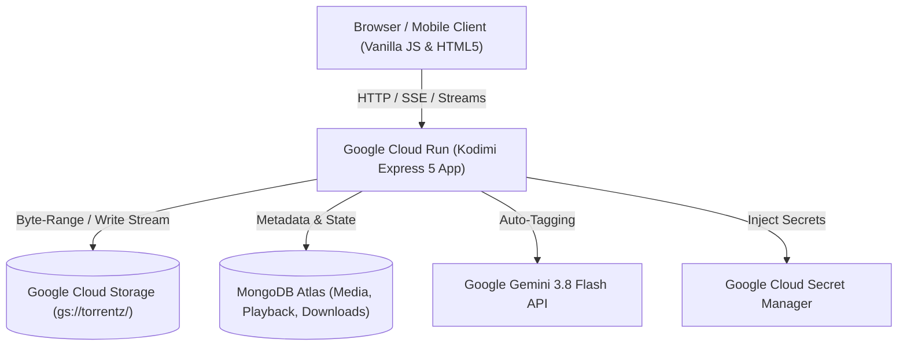

# 🎬 Kodimi (C O D I M I)

> **A modern, self-hosted personal streaming platform inspired by Kodi and Netflix.**  
> Stream movies and series directly from Google Cloud Storage with real-time adaptive transcoding, AI-powered metadata tagging via Google Gemini, multi-track subtitles, and a PIN-protected private vault.

---

## ✨ Features

- **🎨 Material Design 3 Dark Interface**:
  - High-resolution dynamic hero billboard with video details.
  - Horizontal scrolling media carousels and responsive grid views.
  - Custom fullscreen video player with playback state resume, volume controls, keyboard shortcuts, and responsive scrubbing.
  - Real-time buffering and loading indicators.

- **⚡ Adaptive Multi-Resolution Streaming**:
  - Real-time **FFMPEG on-the-fly transcoding**: stream at `144p`, `240p`, `360p`, `480p`, `720p`, or `Original`.
  - **Universal AAC Remux (`-c:v copy -c:a aac`)**: ensures guaranteed audio playback in all browsers, even for MKV files with EAC3/AC3 audio tracks.
  - **Direct Raw Passthrough**: HTTP 206 Partial Content byte-range streaming for zero-latency direct playback.
  - Seamless resolution switching preserving playback time offset.

- **💬 Multi-Track Subtitle Engine**:
  - Automatically probes all embedded subtitle tracks (`ffprobe`).
  - Converts subtitle streams to browser-native WebVTT on-the-fly (`-c:s webvtt`).
  - Interactive language selector menu with keyboard toggle shortcut (`C`).

- **🤖 AI-Powered Metadata Auto-Tagging**:
  - Powered by **Google Gemini 3.8 Flash** (`@google/genai`).
  - Parses complex scene/release filenames (`Arcane.S02E07.1080p...`, `The.Boys.S04E04...`).
  - Extracts canonical show titles, season & episode numbers, and episode names.
  - Generates Netflix-grade plot summaries, genre classifications, and mood tags.

- **🖼️ Smart Cover & Thumbnail Generation**:
  - Automatically captures high-resolution video frame screenshots using FFMPEG.
  - Supports 10-bit HEVC (`yuv420p10le`), HDR, and standard codecs with color format normalization.
  - Built-in SVG fallback art generator for fast, reliable cover rendering.

- **🔒 PIN-Protected Private Vault**:
  - Strict segregation: adult/private content is filtered out of all public carousels, searches, and catalogs.
  - Dedicated 4-digit PIN authentication (`POST /api/auth/verify-pin`).
  - Video streams and thumbnails for private media require vault authorization (`403 Forbidden` if locked).
  - Quick "Lock Vault" button to instantly secure the session.

- **📥 Universal Ingestion & Downloader**:
  - Direct ingestion of **Magnet URIs**, **.torrent files/links**, and **Direct HTTP/HTTPS video URLs**.
  - Streams downloads directly into Google Cloud Storage write streams (`createWriteStream`), bypassing server disk limits.
  - Real-time Server-Sent Events (SSE) progress bar with download speed (MB/s), ETA, and peer count.
  - Triggers automatic Gemini AI metadata enrichment upon download completion.

- **☁️ Cloud Native Architecture**:
  - Containerized with Docker and ready for single-command deployment to **Google Cloud Run**.
  - Integrated with **Google Secret Manager** for zero-plaintext secret security.
  - Backed by **MongoDB** with in-memory read caching for sub-millisecond API response times.

---

## 🏗️ Architecture



---

## 🚀 Quick Start (Local Development)

### Prerequisites
- Node.js 22+
- FFMPEG installed and available on `PATH`
- MongoDB database (local or Atlas)
- Google Cloud project with Cloud Storage bucket and service account key

### 1. Clone & Install
```bash
git clone https://github.com/ismailisimba/kodimi.git
cd kodimi
npm install
```

### 2. Configure Environment Variables
Copy `.env.example` to `.env` and fill in your details:
```bash
cp .env.example .env
```

| Variable | Description | Example |
| :--- | :--- | :--- |
| `PORT` | Local server port | `3000` |
| `NODE_ENV` | Environment (`development` or `production`) | `development` |
| `GCP_PROJECT_ID` | Google Cloud Project ID | `ismizo` |
| `GCS_BUCKET_NAME` | Cloud Storage bucket containing media | `torrentz` |
| `GOOGLE_APPLICATION_CREDENTIALS` | Path to GCP Service Account JSON key | `./config/key.json` |
| `ADMIN_PASSWORD` | Master password to access Kodimi | `kodimi123` |
| `PRIVATE_PIN` | 4-digit PIN for Private Vault | `1234` |
| `MONGO_URI` | MongoDB connection string | `mongodb+srv://...` |
| `GEMINI_API_KEY` | Google Gemini API key for AI metadata | `AIzaSy...` |
| `JWT_SECRET` | Secret key for signing auth tokens | `your_secret_key` |

### 3. Start the Platform
```bash
npm start
```
Open **[http://localhost:3000](http://localhost:3000)** in your browser!

---

## 🐳 Docker Deployment

You can build and run Kodimi anywhere with Docker:

```bash
docker build -t kodimi .
docker run -p 8080:8080 --env-file .env kodimi
```

---

## ☁️ Google Cloud Run Deployment

Kodimi is designed for serverless scalability on Google Cloud Run.

### 1. Store Secrets in Secret Manager
```bash
gcloud secrets create KODIMI_ADMIN_PASSWORD --data-file=- <<< "your_password"
gcloud secrets create KODIMI_PRIVATE_PIN --data-file=- <<< "1234"
gcloud secrets create KODIMI_MONGO_URI --data-file=- <<< "mongodb+srv://..."
gcloud secrets create KODIMI_GEMINI_API_KEY --data-file=- <<< "your_gemini_key"
gcloud secrets create KODIMI_JWT_SECRET --data-file=- <<< "your_jwt_secret"
```

### 2. Deploy to Cloud Run
Using the provided PowerShell or Bash script:
```powershell
.\scripts\deploy_cloud_run.ps1
```
Or via Bash:
```bash
bash ./scripts/deploy_cloud_run.sh
```

---

## ⌨️ Player Keyboard Shortcuts

| Key | Action |
| :--- | :--- |
| `Space` / `K` | Play / Pause |
| `Left Arrow` | Rewind 10 seconds |
| `Right Arrow` | Fast Forward 10 seconds |
| `C` | Cycle / Toggle Subtitles |
| `M` | Mute / Unmute Audio |
| `F` | Toggle Fullscreen |
| `Esc` | Exit Fullscreen / Close Player |

---

## 📄 License

This project is licensed under the [MIT License](LICENSE) - Copyright (c) 2026 Ismail Simba.
